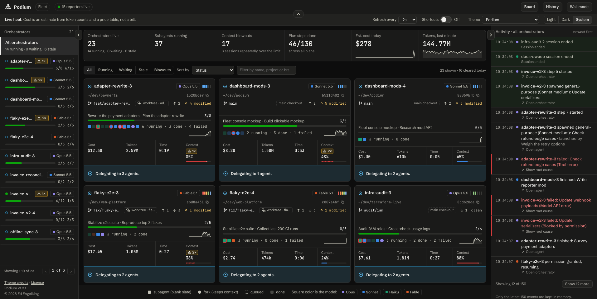

<p align="center">
  
</p>

**A Claude Code session is waiting on you...**

Run a few sessions at once and it happens fast. One is stopped at a permission prompt. One has filled its
context window. A subagent failed ten minutes ago and nothing told you. The only way to find out is to
click through every terminal, and that takes more effort than the work itself.

Podium is a single pane of glass for Claude Code. Whether it's just you or your whole team, every session
shows up in one browser tab, so you can see what all of them are doing at a glance. Each session appears
within about two seconds of its first prompt and leaves when it ends, with no refresh.

**There are other tools like this.** Podium started as something I built for myself, because I run several
Claude Code sessions at once and was tired of clicking through terminals to find the one that needed me. It
turned out to be useful enough to share. I haven't compared it with every similar tool, so if another one fits
how you work better, use that one. If you try Podium and something is missing, I'd like to hear about it.



For every session you see:

- its model, effort and plan, and the git branch or worktree it works in
- the agents it launched (subagents and forks), and what each one costs
- how full each context window is, and how often one blew out
- why anything failed

Podium watches. The one thing it can send is an answer to a session that waits on you (a question, a plan,
a tool's permission prompt, a message, `/clear` or `/compact`), and only once the server's Admin and the
session's owner have both turned that on. It never types into a terminal.

Run it for yourself on one machine, or point a whole team's sessions at one server and the console groups
the wall by person. The Claude Code mod, `podium-reporter`, sends the data.

New here? The [user guide](docs/USER_GUIDE.md) walks through setup and reading the dashboard, and the
[documentation table](#documentation) below lists everything else.

Cost in Podium is an estimate from token counts and a price table. The table starts as Anthropic's list
prices and you can change any price in Admin > Model prices. It is never a bill.

## Quick start

Requires Node 24 and npm.

```sh
npm install
npm run dev          # server on http://127.0.0.1:4317, Vite UI on http://localhost:5173
```

Open http://localhost:5173/#/. With nothing reporting yet, the wall says how to start a session.

To see it with simulated sessions instead of real ones, in a second terminal:

```sh
npm run podium:sim -- --sessions 5 --chaos
```

`--chaos` adds sessions that go silent, more failures and more context blowouts. `--help` lists the
other options (`--url`, `--speed`, `--seed`, `--duration`, `--agents`, `--token`, `--person`, `--unnamed`, `--print`). Stop it
with Ctrl-C; it ends every session it started, and they leave the dashboard a few seconds later. If the
server has a token (`podiumctl start` sets one), pass it: `--token "$(podiumctl token)"`.

To see the people view, give the simulator people with a token each from Admin:
`--person "Ed E.=<Ed's token>" --person "Priya N.=<Priya's token>" --unnamed`. Sessions go to the people in
turn, each on a laptop and every third one on a build box; `--unnamed` keeps a share of sessions with no name,
which show under Admin when they send the admin secret with `--token`.

To serve the built UI and the API without a container, `npm run build` and then `npm run start -w server`
(http://127.0.0.1:4317). To run it as a managed service, see [Running the server](docs/SERVER.md).

## Documentation

| Read | To |
|---|---|
| [User guide](docs/USER_GUIDE.md) | Set Podium up, read the dashboard and use Admin |
| [Running the server](docs/SERVER.md) | Run it with `podiumctl`, let a team report to one server, put it [behind a reverse proxy](docs/SERVER.md#behind-a-reverse-proxy), and change its settings |
| [The reporter mod](docs/REPORTER.md) | Install `podium-reporter`, set its options and see what leaves a session |
| [Gotchas](docs/GOTCHAS.md) | Sharp edges that are easy to hit, including [why one machine shows several rows on the Reporters page](docs/GOTCHAS.md#reporters-and-machines) |
| [Demo](docs/DEMO.md) | A script and a paste-in prompt for showing Podium to other people |
| [Spec](docs/SPEC.md) | The build spec: intended behavior and requirements |
| [Architecture](docs/ARCHITECTURE.md) | How it was built, where it departs from the spec and why, what was verified, known issues |
| [Decisions](docs/DECISIONS.md) | Why the significant choices were made |
| [Changelog](CHANGELOG.md) | What changed in each release |
| [Contributing](CONTRIBUTING.md) | How to propose and land a change, and the tests and checks to run (PRs go to `development`, not `main`) |
| [Security](.github/SECURITY.md) | How to report a vulnerability (privately) |
| [Code of conduct](.github/CODE_OF_CONDUCT.md) | Community expectations |
| [Third-party notices](docs/THIRD_PARTY_NOTICES.md) | Credits and licenses for the color theme palettes |

Podium is released under the [MIT License](LICENSE).
